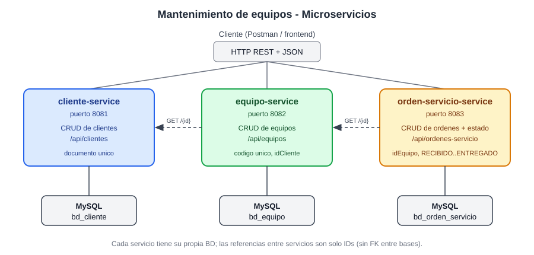
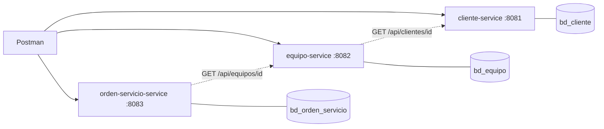

# Evaluacion 03 - Microservicios - Mantenimiento de equipos

**Curso:** Desarrollo de Aplicaciones Web Avanzado (4 C24) - Prof. Coello Palomino, Ricardo
**Estudiante:** Guevara Garrido, Piero Estefano  |  **Tema asignado (N.o 8):** Mantenimiento de equipos
**Microservicios:** Cliente, Equipo y Orden de servicio (en el enunciado aparece como *Laboratorio 09*)

## 1. Requisitos
- JDK 21
- Maven 3.9+ (o el Maven integrado de IntelliJ IDEA)
- MySQL 8 (XAMPP o MySQL Server) en `localhost:3306`, usuario `root` sin contrasena (dev)
- Postman

## 2. Arquitectura





| Microservicio | Responsabilidad | Puerto | Base de datos | Tabla |
|---|---|---|---|---|
| `cliente-service` | Administrar clientes | 8081 | `bd_cliente` | `cliente` |
| `equipo-service` | Administrar equipos de los clientes | 8082 | `bd_equipo` | `equipo` |
| `orden-servicio-service` | Ordenes de servicio y su estado | 8083 | `bd_orden_servicio` | `orden_servicio` |

Los servicios **no comparten tablas**. `Equipo.idCliente` y `OrdenServicio.idEquipo` son solo IDs; al crear/actualizar
(si el ID cambia) el servicio consulta por HTTP (`RestClient`) al servicio dueno del dato. Si el ID no existe responde
**400**, y si el otro servicio esta caido responde **503**. Esta verificacion se apaga con `servicios.validar-referencias: false`.

Estructura de paquetes de cada servicio: `model`, `dto`, `repository`, `services`, `controller`, `exception`
(mas `client` en equipo y orden para consultar al otro servicio).

## 3. Base de datos
- Dev: Hibernate crea las tablas solo (`ddl-auto: update`) y `createDatabaseIfNotExist=true` crea la base.
- Script / evidencia: `sql/01_crear_bases_y_tablas.sql` (crea las 3 bases y tablas) y `sql/02_datos_demo_opcional.sql`.
- Prod: `ddl-auto: none` -> ejecutar primero el script `01`.

## 4. Pasos de ejecucion
1. Iniciar MySQL (XAMPP -> Start en MySQL).
2. Abrir cada carpeta como proyecto Maven (IntelliJ) o por consola, **en este orden**:
```bash
cd cliente-service && mvn spring-boot:run
cd equipo-service && mvn spring-boot:run
cd orden-servicio-service && mvn spring-boot:run
```
3. Verificar en phpMyAdmin que existen `bd_cliente`, `bd_equipo` y `bd_orden_servicio`.
4. Importar en Postman `postman/Evaluacion03_Mantenimiento_Equipos.postman_collection.json` y ejecutarla con
   *Collection Runner* (en orden). Las variables `clienteId`, `equipoId`, `ordenId` se llenan solas.

## 5. Perfiles `dev` / `prod`
El perfil se elige con la variable `PROFILE_ACTIVE` (por defecto `dev`). Ejemplo prod (PowerShell):
```powershell
$env:PROFILE_ACTIVE="prod"; $env:DB_USER="root"; $env:DB_PASSWORD="tu_clave"; mvn spring-boot:run
```

| Valor | `dev` | `prod` |
|---|---|---|
| Conexion BD | `localhost:3306/<bd>`, usuario `root`, sin clave (en el YAML) | `DB_URL`, `DB_USER`, `DB_PASSWORD` por variables de entorno (sin credenciales en el repo) |
| `ddl-auto` | `update` (crea/ajusta tablas) | `none` (se usa el script SQL) |
| `show-sql` | `true` | `false` |
| Logging | `DEBUG` del paquete `com.tecsup.*` | `WARN` global / `INFO` del paquete |
| Puerto | 8081 / 8082 / 8083 | `SERVER_PORT` (por defecto el mismo) |
| URL del otro servicio | `localhost` fijo | `CLIENTE_SERVICE_URL` / `EQUIPO_SERVICE_URL` |

## 6. Endpoints

### cliente-service (`http://localhost:8081`)
| Metodo | Ruta | Descripcion | Respuestas |
|---|---|---|---|
| GET | `/api/clientes` | Listar | 200 |
| GET | `/api/clientes/{id}` | Buscar por ID | 200 / 404 |
| POST | `/api/clientes` | Registrar | 201 / 400 / 409 (documento repetido) |
| PUT | `/api/clientes/{id}` | Actualizar | 200 / 400 / 404 / 409 |
| DELETE | `/api/clientes/{id}` | Eliminar | 204 / 404 |

### equipo-service (`http://localhost:8082`)
| Metodo | Ruta | Descripcion | Respuestas |
|---|---|---|---|
| GET | `/api/equipos` | Listar | 200 |
| GET | `/api/equipos/{id}` | Buscar por ID | 200 / 404 |
| GET | `/api/equipos/cliente/{idCliente}` | Equipos de un cliente | 200 |
| POST | `/api/equipos` | Registrar | 201 / 400 (datos o cliente inexistente) / 409 (codigo repetido) / 503 |
| PUT | `/api/equipos/{id}` | Actualizar | 200 / 400 / 404 / 409 / 503 |
| DELETE | `/api/equipos/{id}` | Eliminar | 204 / 404 |

### orden-servicio-service (`http://localhost:8083`)
| Metodo | Ruta | Descripcion | Respuestas |
|---|---|---|---|
| GET | `/api/ordenes-servicio` | Listar (opcional `?estado=LISTO`) | 200 / 400 |
| GET | `/api/ordenes-servicio/{id}` | Buscar por ID | 200 / 404 |
| GET | `/api/ordenes-servicio/equipo/{idEquipo}` | Ordenes de un equipo | 200 |
| POST | `/api/ordenes-servicio` | Crear (estado por defecto `RECIBIDO`, fecha por defecto hoy) | 201 / 400 / 503 |
| PUT | `/api/ordenes-servicio/{id}` | Actualizar | 200 / 400 / 404 / 503 |
| PATCH | `/api/ordenes-servicio/{id}/estado` | Cambiar estado (`RECIBIDO`, `EN_REPARACION`, `LISTO`, `ENTREGADO`) | 200 / 400 / 404 |
| DELETE | `/api/ordenes-servicio/{id}` | Eliminar | 204 / 404 |

### Ejemplos de JSON
```json
// POST /api/clientes
{ "documento": "70123456", "nombres": "Piero", "apellidos": "Guevara Garrido", "correo": "piero@example.com", "telefono": "999111222" }

// POST /api/equipos
{ "codigo": "EQ-0001", "tipo": "Laptop", "marca": "Lenovo", "modelo": "ThinkPad E14", "idCliente": 1 }

// POST /api/ordenes-servicio
{ "idEquipo": 1, "descripcion": "No enciende, revisar fuente de poder", "costoEstimado": 120.50 }

// PATCH /api/ordenes-servicio/1/estado
{ "estado": "EN_REPARACION" }
```

### Formato de error (todas las APIs)
```json
{
  "timestamp": "2026-11-05T10:15:30.123",
  "status": 400,
  "error": "Bad Request",
  "message": "Datos de entrada invalidos",
  "path": "/api/clientes",
  "errors": { "documento": "El documento debe tener entre 8 y 20 caracteres", "correo": "El correo no tiene un formato valido" }
}
```

## 7. Validaciones principales
- Cliente: documento (8-20, unico), nombres, apellidos y correo obligatorios, correo con formato valido, telefono opcional con patron.
- Equipo: codigo (unico), tipo, marca y modelo obligatorios; `idCliente` obligatorio, positivo y existente en cliente-service.
- Orden: `idEquipo` obligatorio y existente; descripcion obligatoria; `costoEstimado` >= 0; fecha de ingreso no futura; estado dentro del enum.

## 8. Limitaciones conocidas
- No se bloquea eliminar un cliente/equipo que tiene registros dependientes en otro servicio (no hay FK entre bases); en un sistema real se resolveria con eventos o validacion cruzada.
- No hay descubrimiento de servicios (Eureka) ni API Gateway: las URLs entre servicios van en el YAML, como indica el enunciado.
